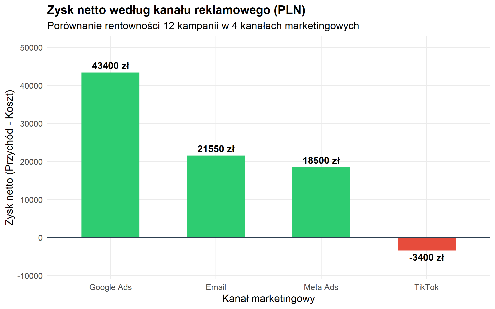

# Audyt efektywności kampanii marketingowych w R
Analiza 12 kampanii z 4 kanałów (Google Ads, Meta Ads, TikTok, Email) na łącznym budżecie 43 150 zł. Główny problem był prosty: patrząc tylko na liczbę kliknięć, TikTok wyglądał świetnie, ale po policzeniu realnego zwrotu okazało się, że jako jedyny przynosi stratę.
Zrobiłem ten projekt w R (`dplyr` + `ggplot2`), żeby przećwiczyć pełny przepływ pracy na danych: od surowej tabeli i liczenia wskaźników biznesowych, przez kategoryzację, aż po wykres i konkretną rekomendację przesunięcia budżetu.

## Wyniki po zsumowaniu kanałów
| Kanał | Kampanie | Koszt | Przychód | Zysk netto | Śr. CAC | Śr. ROAS | Decyzja |
| :--- | :---: | :---: | :---: | :---: | :---: | :---: | :--- |
| Google Ads | 3 | 16 600 zł | 60 000 zł | 43 400 zł | 42,02 zł | 3,61 | Skalować |
| Email | 3 | 2 450 zł | 24 000 zł | 21 550 zł | 12,31 zł | 9,76 | Skalować |
| Meta Ads | 3 | 12 600 zł | 31 100 zł | 18 500 zł | 51,71 zł | 2,46 | Optymalizować |
| TikTok | 3 | 11 500 zł | 8 100 zł | -3 400 zł | 112,98 zł | 0,72 | Wyłączyć |
| **Razem** | **12** | **43 150 zł** | **123 200 zł** | **80 050 zł** | — | — | — |


## Co z tego wynika?
* **TikTok do wyłączenia.** Zjadł ponad 1/4 całego budżetu (11 500 zł), a wygenerował 3 400 zł straty (ROAS 0,72). Koszt pozyskania jednego zamówienia (112,98 zł) był tam prawie 3 razy wyższy niż w Google Ads.
* **Google Ads ciągnie wynik.** Wygenerował ponad połowę całego zysku firmy (43 400 zł) przy stabilnym ROAS 3,61.
* **Email daje najlepszą marżę.** Przy koszcie 2 450 zł przyniósł 21 550 zł na czysto (ROAS 9,76, CAC 12,31 zł). Tutaj na pewno warto dorzucić środki z wyłączonego TikToka.
* **Meta Ads zarabia, ale wymaga poprawy.** 18 500 zł zysku to dobry wynik, ale ROAS (2,46) jest wyraźnie słabszy niż w wyszukiwarce – warto przejrzeć kreacje i grupy odbiorców przed ewentualnym zwiększaniem stawek.

## Co siedzi w kodzie?
Całość jest w jednym pliku `audyt_kampanii.R`:
* `dplyr` (`mutate`, `case_when`, `group_by`, `summarise`, `arrange`) – policzenie CAC, ROAS, zysku netto i automatyczne przypisanie decyzji na podstawie progów ROAS (`>= 3.0`, `1.0–3.0`, `< 1.0`).
* `ggplot2` (`geom_col`, `geom_hline`, `geom_text`, `reorder`) – wygenerowanie i zapis wykresu zysku netto (`ggsave`).

## Jak uruchomić
Wystarczy otworzyć `audyt_kampanii.R` w RStudio i odpalić całość. Wymagane pakiety:
```r
install.packages(c("dplyr", "ggplot2"))
```
